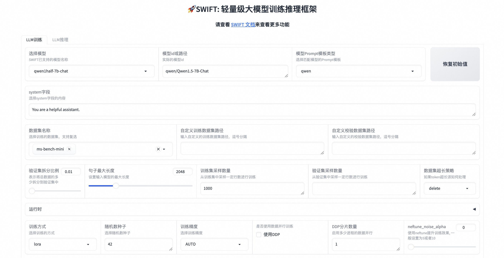

# SWIFT (Scalable lightWeight Infrastructure for Fine-Tuning)

<p align="center">
    <br>
    
    <br>
<p>
<p align="center">
<a href="https://modelscope.cn/home">魔搭社区官网</a>
<br>
        中文&nbsp ｜ &nbsp<a href="README.md">English</a>&nbsp
</p>


<p align="center">


<a href="https://github.com/modelscope/modelscope/"></a>
<a href="https://pypi.org/project/ms-swift/"></a>
<a href="https://github.com/modelscope/swift/blob/main/LICENSE"></a>
<a href="https://pepy.tech/project/ms-swift"></a>
<a href="https://github.com/modelscope/swift/pulls"></a>
</p>

<p align="center">
<a href="https://trendshift.io/repositories/6427" target="_blank"></a>
</p>

##  📖 目录
- [简介](#-简介)
- [用户群](#-用户群)
- [新闻](#-新闻)
- [安装](#-%EF%B8%8F-安装)
- [快速开始](#-快速开始)
- [教程](#-教程)
- [License](#-license)
- [引用](#-引用)

## 📝 简介
SWIFT支持**300+ LLM和50+ MLLM**（多模态大模型）的训练(预训练、微调、对齐)、推理、评测和部署。开发者可以直接将我们的框架应用到自己的Research和生产环境中，实现模型训练评测到应用的完整链路。我们除支持了[PEFT](https://github.com/huggingface/peft)提供的轻量训练方案外，也提供了一个完整的**Adapters库**以支持最新的训练技术，如NEFTune、LoRA+、LLaMA-PRO等，这个适配器库可以脱离训练脚本直接使用在自己的自定流程中。

为方便不熟悉深度学习的用户使用，我们提供了一个Gradio的web-ui用于控制训练和推理，并提供了配套的深度学习课程和最佳实践供新手入门。 可以在[Huggingface space](https://huggingface.co/spaces/tastelikefeet/swift) 和 [ModelScope创空间](https://www.modelscope.cn/studios/iic/Scalable-lightWeight-Infrastructure-for-Fine-Tuning/summary) 中体验SWIFT web-ui功能了。

SWIFT具有丰富全面的文档，请查看我们的文档网站:
<p align="center">
        <a href="https://arxiv.org/abs/2408.05517">论文</a> &nbsp ｜ <a href="https://swift.readthedocs.io/en/latest/">English Documentation</a> &nbsp ｜ &nbsp <a href="https://swift.readthedocs.io/zh-cn/latest/">中文文档</a> &nbsp
</p>

## ☎ 用户群

请扫描下面的二维码来加入我们的交流群：

[Discord Group](https://discord.com/invite/D27yfEFVz5)              |  微信群
:-------------------------:|:-------------------------:
  |  


## 🎉 新闻
- 🔥2024.08.12: 🎉 SWIFT论文已经发布到arXiv上，可以点击[这个链接](https://arxiv.org/abs/2408.05517)阅读.
- 🔥2024.08.12: 支持packing和flash-attention时不污染attention_mask, 使用`--packing`开启。详情见[PR](https://github.com/huggingface/transformers/pull/31629/files).
- 🔥2024.08.09: 支持qwen2-audio模型的推理与微调. 最佳实践可以查看[这里](https://github.com/modelscope/ms-swift/issues/1653).
- 🔥2024.08.08: 支持qwen2-math系列模型, 1.5B, 7B, 72B. 使用`swift infer --model_type qwen2-math-1_5b-instruct`进行体验.
- 🔥2024.08.07: 支持使用vllm对多模态大模型: llava系列, internvl2系列, phi3-vision, minicpm-v2.5进行推理加速和部署. 可以查看[多模态&vLLM推理加速文档](docs/source/Multi-Modal/vLLM推理加速文档.md)获取更多信息.
- 2024.08.06: 支持minicpm-v-v2_6-chat, 使用`swift infer --model_type minicpm-v-v2_6-chat`进行推理体验, 最佳实践可以查看[这里](https://github.com/modelscope/swift/issues/1613).
- 2024.08.06: 支持internlm2.5的1.8b和20b系列. 使用`swift infer --model_type internlm2_5-1_8b-chat`进行体验.
- 🔥2024.08.05: 支持多模态数据集的评测！命令行完全一致，新增了许多[多模态数据集](https://swift.readthedocs.io/zh-cn/latest/LLM/LLM%E8%AF%84%E6%B5%8B%E6%96%87%E6%A1%A3.html#id2).
- 🔥2024.08.02: 支持Fourier Ft训练. 使用方式为`--sft_type fourierft`, 参数可以参考[这里](https://swift.readthedocs.io/zh-cn/latest/LLM/%E5%91%BD%E4%BB%A4%E8%A1%8C%E5%8F%82%E6%95%B0.html).
- 🔥2024.07.29: 支持使用lmdeploy对LLM和VLM模型进行推理加速. 文档可以查看[这里](docs/source/Multi-Modal/LmDeploy推理加速文档.md).
- 🔥2024.07.24: 人类偏好对齐算法支持视觉多模态大模型, 包括DPO/ORPO/SimPO/CPO, 训练参考[文档](docs/source/Multi-Modal/人类偏好对齐训练文档.md). 支持数据集RLAIF-V.
- 🔥2024.07.24: 支持使用megatron对qwen2系列进行CPT和SFT. 可以查看[megatron训练文档](docs/source/LLM/Megatron训练文档.md).
- 🔥2024.07.24: 支持llama3.1系列模型. 包含8b, 70b, 405b. 支持openbuddy-llama3_1-8b-chat.
- 2024.07.20: 支持mistral-nemo系列模型. 使用`--model_type mistral-nemo-base-2407`以及`--model_type mistral-nemo-instruct-2407`开始训练和推理.
- 🔥2024.07.19: 支持[Q-Galore](https://arxiv.org/abs/2407.08296)算法, 该算法可以减少显存使用约60% (qwen-7b-chat, full, 80G -> 35G), 使用命令行:`swift sft --model_type xxx --use_galore true --galore_quantization true`来开始训练!
- 2024.07.17: 支持InternVL2系列新模型: `model_type`分别为internvl2-1b, internvl2-40b, internvl2-llama3-76b. 最佳实践可以查看[这里](docs/source/Multi-Modal/internvl最佳实践.md).
- 2024.07.17: 支持[NuminaMath-7B-TIR](https://www.modelscope.cn/models/AI-ModelScope/NuminaMath-7B-TIR)的训练和推理. model_type可以使用`numina-math-7b`.
- 🔥2024.07.16: 支持ollama和bitsandbytes导出. 可以使用命令: `swift export --model_type xxx --to_ollama true`或者`swift export --model_type xxx --quant_method bnb --quant_bits 4`.
- 2024.07.08: 支持cogvlm2-video-13b-chat. 最佳实践可以查看[这里](docs/source/Multi-Modal/cogvlm2-video最佳实践.md).
- 2024.07.08: 支持internlm-xcomposer2_5-7b-chat. 最佳实践可以查看[这里](docs/source/Multi-Modal/internlm-xcomposer2最佳实践.md).
- 🔥2024.07.06: 支持llava-next-video系列模型: llava-next-video-7b-instruct, llava-next-video-7b-32k-instruct, llava-next-video-7b-dpo-instruct, llava-next-video-34b-instruct. 可以查看[llava-video最佳实践](docs/source/Multi-Modal/llava-video最佳实践.md)了解更多.
- 🔥2024.07.06: 支持InternVL-2系列: internvl2-2b, internvl2-4b, internvl2-8b, internvl2-26b.
- 2024.07.06: 支持codegeex4-9b-chat.
- 2024.07.04: 支持internlm2_5-7b系列: internlm2_5-7b, internlm2_5-7b-chat, internlm2_5-7b-chat-1m.
- 2024.07.02: 支持`llava1_6-vicuna-7b-instruct`, `llava1_6-vicuna-13b-instruct`等llava-hf模型. 最佳实践可以查看[这里](docs/source/Multi-Modal/llava最佳实践.md).
- 🔥2024.06.29: 支持[eval-scope](https://github.com/modelscope/eval-scope)&[open-compass](https://github.com/open-compass/opencompass)评测! 我们支持了包含`BoolQ, ocnli, humaneval, math, ceval, mmlu, gsk8k, ARC_e`等50+标准数据集在内的评测流程, 请查看我们的[评测文档](https://github.com/modelscope/swift/blob/main/docs/source/LLM/LLM评测文档.md)来使用。下个迭代我们会支持多模态评测和Agent评测，记得持续关注我们: )
<details><summary>More</summary>

- 🔥2024.06.28: 支持**Florence**系列模型: 可以查看[Florence最佳实践](docs/source/Multi-Modal/florence最佳实践.md).
- 🔥2024.06.28: 支持**Gemma2**系列模型: gemma2-9b, gemma2-9b-instruct, gemma2-27b, gemma2-27b-instruct.
- 🔥2024.06.18: 支持**DeepSeek-Coder-v2**系列模型! 使用model_type`deepseek-coder-v2-instruct`和`deepseek-coder-v2-lite-instruct`来开启训练和推理.
- 🔥2024.06.16: 支持**KTO**和**CPO**训练，使用`swift rlhf --rlhf_type kto`和`swift rlhf --rlhf_type cpo`来开始训练，可以参考[文档](./docs/source/LLM/人类偏好对齐训练文档.md).
- 2024.06.11: 支持符合OpenAI接口的工具调用Agent部署, 可以查看[Agent部署最佳实践](docs/source/LLM/Agent部署最佳实践.md).
- 🔥2024.06.07: 支持**Qwen2**系列LLM, 包括0.5B、1.5B、7B、72B的Base和Instruct模型, 以及对应的gptq-int4、gptq-int8、awq-int4量化版本. 使用双卡80GiB A100对Qwen2-72B-Instruct进行自我认知微调并推理部署的最佳实践可以查看[这里](https://github.com/modelscope/swift/issues/1092).
- 🔥2024.06.05: 支持glm4系列大模型和glm4v-9b-chat多模态大模型, 可以查看[glm4v最佳实践](docs/source/Multi-Modal/glm4v最佳实践.md).
- 🔥2024.06.01: 支持**SimPO**训练，使用`swift simpo`来开始训练，最佳实践可以查看[这里](https://github.com/modelscope/swift/tree/main/docs/source/LLM/SimPO算法最佳实践.md)
- 🔥2024.06.01: 支持多模态大模型部署, 可以查看[多模态部署文档](docs/source/Multi-Modal/MLLM部署文档.md).
- 2024.05.31: 支持Mini-Internvl多模态模型, 使用model_type `mini-internvl-chat-2b-v1_5`和`mini-internvl-chat-4b-v1_5`来训练.
- 2024.05.24: 支持Phi3多模态模型, 使用model_type `phi3-vision-128k-instruct`来训练.
- 2024.05.22: 支持DeepSeek-V2-lite系列模型, model_type为 `deepseek-v2-lite`和`deekseek-v2-lite-chat`
- 2024.05.22: 支持TeleChat-12b-v2模型和量化版本, model_type为 `telechat-12b-v2`和`telechat-12b-v2-gptq-int4`
- 🔥2024.05.21: 支持 MiniCPM-Llama3-V-2_5 的推理与微调, 可以查看[minicpm-v-2.5最佳实践](docs/source/Multi-Modal/minicpm-v-2.5最佳实践.md).
- 🔥2024.05.20: 支持 cogvlm2-llama3-chinese-chat-19B, cogvlm2-llama3-chat-19B 的推理与微调, 可以查看[cogvlm2最佳实践](docs/source/Multi-Modal/cogvlm2最佳实践.md).
- 🔥2024.05.17: 支持peft=0.11.0. 同时支持了三个新的tuner方法： `BOFT`, `Vera` 和 `Pissa`. 使用 `--sft_type boft/vera` 开启BOFT或者Vera, 使用 `--init_lora_weights pissa` 以及 `--sft_type lora` 来使用 Pissa.
- 2024.05.16: 支持Llava-Next (Stronger)系列模型，最佳实践可以查看[这里](https://github.com/modelscope/swift/tree/main/docs/source/Multi-Modal/llava最佳实践.md).
- 🔥2024.05.13: 支持Yi-1.5系列模型，使用`--model_type yi-1_5-9b-chat`等开始体验
- 2024.05.11: 支持使用[hqq](https://github.com/mobiusml/hqq)和[eetq](https://github.com/NetEase-FuXi/EETQ)进行qlora训练和量化推理，可以查看[LLM量化文档](https://github.com/modelscope/swift/tree/main/docs/source/LLM/LLM量化文档.md)
- 2024.05.10: 支持序列并行. 先安装`pip install .[seq_parallel]`, 之后在DDP环境中添加`--sequence_parallel_size n`即可使用!
- 2024.05.08: 支持DeepSeek-V2-Chat模型, 训练参考[这个脚本](https://github.com/modelscope/swift/blob/main/examples/pytorch/llm/scripts/deepseek-v2-chat/lora_ddp_ds3/sft.sh)。支持InternVL-Chat-V1.5-Int8模型，最佳实践参考[这里](https://github.com/modelscope/swift/tree/main/docs/source/Multi-Modal/internvl最佳实践.md).
- 🔥2024.05.07: 支持**ORPO**训练，使用`swift orpo`来开始训练， 最佳实践可以查看[这里](https://github.com/modelscope/swift/tree/main/docs/source/LLM/ORPO算法最佳实践.md)
- 2024.05.07: 支持来自xtuner的Llava-Llama3模型，model_type为`llava-llama-3-8b-v1_1`.
- 2024.04.29: 支持InternVL-Chat-V1.5的推理与微调, 最佳实践可以查看[这里](https://github.com/modelscope/swift/tree/main/docs/source/Multi-Modal/internvl最佳实践.md).
- 🔥2024.04.26: 支持**LISA** 和 **unsloth**训练！指定 `--lisa_activated_layers=2` 来开启LISA（显存使用降低至全参训练的30%），指定 `--tuner_backend unsloth` 来使用unsloth，用更少的显存（30%或更少）更快的速度（5x）训练一个超大模型！
- 🔥2024.04.26: 支持Qwen1.5-110B和Qwen1.5-110B-Chat模型的推理与微调, 使用[这个脚本](https://github.com/modelscope/swift/blob/main/examples/pytorch/llm/scripts/qwen1half_110b_chat/lora_ddp_ds/sft.sh)来开始训练！
- 2024.04.24: 支持Phi3系列模型的推理与微调. 包括: [phi3-4b-4k-instruct](examples/pytorch/llm/scripts/phi3_4b_4k_instruct/lora), phi3-4b-128k-instruct.
- 2024.04.22: 支持**chinese-llama-alpaca-2**系列模型的推理与微调和部署等. 包括：chinese-llama-2-1.3b, chinese-llama-2-7b, chinese-llama-2-13b, chinese-alpaca-2-1.3b, chinese-alpaca-2-7b和chinese-alpaca-2-13b以及对应的16k和64k长文本模型.
- 2024.04.22: 支持Llama3 GPTQ-Int4, GPTQ-Int8, AWQ系列模型的推理与微调. 支持chatglm3-6b-128k, Openbuddy-llama3的推理与微调.
- 2024.04.20: 支持**Atom**系列模型的推理, 微调和部署等. 包括: Atom-7B and Atom-7B-Chat. 使用[这个脚本](https://github.com/modelscope/swift/blob/main/examples/pytorch/llm/scripts/atom_7b_chat/lora/sft.sh)来开始训练！
- 2024.04.19: 支持NPU的单卡、DDP、ZeRO2和ZeRO3的训练与推理, 可以查看[NPU推理与微调最佳实践](docs/source/LLM/NPU推理与微调最佳实践.md).
- 2024.04.19: 支持**Llama3**系列模型的推理, 微调和部署等. 包括: Llama-3-8B, Llama-3-8B-Instruct, Llama-3-70B, Llama-3-70B-Instruct. 使用[这个脚本](https://github.com/modelscope/swift/blob/main/examples/pytorch/llm/scripts/llama3_8b_instruct/lora/sft.sh)开始训练叭！
- 2024.04.18: 支持模型: wizardlm2-7b-awq, wizardlm2-8x22b, yi-6b-chat-awq, yi-6b-chat-int8, yi-34b-chat-awq, yi-34b-chat-int8. 支持`--deepspeed zero3-offload`, 提供了默认zero3-offload配置文件来使用zero3+cpu offload.
- 2024.04.18: 支持使用环境变量`USE_HF`兼容HuggingFace生态, 切换成使用HF中的模型和数据集, 可以查看[HuggingFace生态兼容文档](https://github.com/modelscope/swift/tree/main/docs/source/LLM/HuggingFace生态兼容.md).
- 2024.04.17: 支持OpenAI样式的接口评测, 可以查看[评测参数接口文档](docs/source/LLM/命令行参数.md#eval参数)来查看使用方法.
- 🔥2024.04.17: 支持 **CodeQwen1.5-7B**系列: CodeQwen1.5-7B, CodeQwen1.5-7B-Chat, CodeQwen1.5-7B-Chat-AWQ, 使用[这个脚本](https://github.com/modelscope/swift/blob/main/examples/pytorch/llm/scripts/codeqwen1half_7b_chat/lora/sft.sh)来开始训练！
- 2024.04.16: 支持llava-v1.6-34b的推理与微调, 最佳实践可以查看[这里](https://github.com/modelscope/swift/tree/main/docs/source/Multi-Modal/llava最佳实践.md).
- 2024.04.13: 支持Mixtral-8x22B-v0.1模型的推理与微调, 使用[这个脚本](https://github.com/modelscope/swift/blob/main/examples/pytorch/llm/scripts/mixtral_moe_8x22b_v1/lora_ddp_ds/sft.sh)来开始训练！
- 2024.04.13: 支持新推出的**MiniCPM**系列: MiniCPM-V-2.0、MiniCPM-2B-128k、MiniCPM-MoE-8x2B和MiniCPM-1B。使用[这个脚本](https://github.com/modelscope/swift/blob/main/examples/pytorch/llm/scripts/minicpm_moe_8x2b/lora_ddp/sft.sh)来开始训练！
- 🔥2024.04.11: 支持一键式模型评测能力! 首批数据集包含MMLU、CEval、ARC等，也支持用户自定义数据集，具体可以[这个文档](docs/source/LLM/LLM评测文档.md)。同时, 我们支持了一个比较trick的方法来做多个消融实验的管理，查看[这个文档](docs/source/LLM/LLM实验文档.md)来使用。
- 🔥2024.04.11: 支持**c4ai-command-r**系列: c4ai-command-r-plus, c4ai-command-r-v01。使用[这个脚本](https://github.com/modelscope/swift/blob/main/examples/pytorch/llm/scripts/c4ai_command_r_plus/lora_mp/sft.sh)来开始训练！
- 2024.04.10: 使用swift微调qwen-7b-chat模型增强模型function call能力，并结合[Modelscope-Agent](https://github.com/modelscope/modelscope-agent)使用，最佳实践可以查看[这里](https://github.com/modelscope/swift/tree/main/docs/source/LLM/Agent微调最佳实践.md#搭配Modelscope-Agent使用)。
- 🔥2024.04.09: 支持`弱智吧`系列数据集. 在[支持的模型和数据集文档](docs/source/LLM/支持的模型和数据集.md)中搜索`ruozhiba`来找到数据集并开始训练！
- 2024.04.08: 支持XVERSE-MoE-A4.2B模型的推理与微调, 使用[这个脚本](https://github.com/modelscope/swift/blob/main/examples/pytorch/llm/scripts/xverse_moe_a4_2b/lora/sft.sh)来开始训练！
- 2024.04.04: 支持使用**QLoRA+FSDP**来使用两张24G显卡训练70B模型, 使用[这个脚本](https://github.com/modelscope/swift/blob/main/examples/pytorch/llm/scripts/llama2_70b_chat/qlora_fsdp/sft.sh)开始训练.
- 🔥2024.04.03: 支持**Qwen1.5-32B**系列: Qwen1.5-32B, Qwen1.5-32B-Chat, Qwen1.5-32B-Chat-GPTQ-Int4。使用[这个脚本](https://github.com/modelscope/swift/blob/main/examples/pytorch/llm/scripts/qwen1half_32b_chat/lora_mp/sft.sh)来开始训练！
- 🔥2024.04.02: 支持Mengzi3-13B-Base模型的推理与微调, 使用[这个脚本](https://github.com/modelscope/swift/blob/main/examples/pytorch/llm/scripts/mengzi3_13b_base/lora_ddp_ds/sft.sh)来开始训练！
- 🔥2024.04.01: 支持**dbrx**系列, dbrx-base和dbrx-instruct, 使用[这个脚本](https://github.com/modelscope/swift/blob/main/examples/pytorch/llm/scripts/dbrx-instruct/lora_mp/sft.sh)来开始训练！.
- 🔥2024.03.29: 支持**Qwen1.5-MoE**系列: Qwen1.5-MoE-A2.7B, Qwen1.5-MoE-A2.7B-Chat, Qwen1.5-MoE-A2.7B-Chat-GPTQ-Int4.
- 🔥2024.03.29: 支持**Grok-1** 300B MoE模型的推理与微调, 最佳实践可以查看[这里](https://github.com/modelscope/swift/tree/main/docs/source/LLM/Grok训练和推理.md).
- 🔥2024.03.25: 支持TeleChat-7b和TeleChat-12b模型的训练和推理, 使用[这个脚本](https://github.com/modelscope/swift/blob/main/examples/pytorch/llm/scripts/telechat_12b/lora/sft.sh)来开始训练！.
- 🔥2024.03.20: 支持**llava**系列的推理与微调, 最佳实践可以查看[这里](https://github.com/modelscope/swift/tree/main/docs/source/Multi-Modal/llava最佳实践.md).
- 🔥2024.03.12: 支持**deepseek-vl**系列推理和微调, 最佳实践可以查看[这里](https://github.com/modelscope/swift/tree/main/docs/source/Multi-Modal/deepseek-vl最佳实践.md).
- 🔥2024.03.11: 支持[GaLore](https://arxiv.org/abs/2403.03507), 用于在全参数训练中有效减小显存占用至原来的1/2.
- 🔥2024.03.10: Qwen1.5-7B-Chat与Qwen1.5-72B-Chat从微调到部署[全流程最佳实践](https://github.com/modelscope/swift/blob/main/docs/source/LLM/Qwen1.5%E5%85%A8%E6%B5%81%E7%A8%8B%E6%9C%80%E4%BD%B3%E5%AE%9E%E8%B7%B5.md).
- 🔥2024.03.09: 支持MAMBA模型的训练和推理, 使用[这个脚本](https://github.com/modelscope/swift/blob/main/examples/pytorch/llm/scripts/mamba-1.4b/lora/sft.sh)来开始训练！.
- 2024.03.09: 支持AQLM量化模型的训练和推理, 使用[这个脚本](https://github.com/modelscope/swift/blob/main/examples/pytorch/llm/scripts/llama2_7b_aqlm_2bit_1x16/lora/sft.sh)开始训练！
- 2024.03.06: 支持AWQ量化模型的训练和推理, 使用[这个Qwen1.5-AWQ模型脚本](https://github.com/modelscope/swift/blob/main/examples/pytorch/llm/scripts/qwen1half_7b_chat_awq/lora/sft.sh)开始训练, 并支持[yi-9b](https://github.com/modelscope/swift/blob/main/examples/pytorch/llm/scripts/yi_9b/lora_zero3)的训练和推理.
- 🔥2024.02.29: 支持[LLaMA PRO](https://arxiv.org/pdf/2401.02415.pdf), 使用[这个脚本](https://github.com/modelscope/swift/blob/main/examples/pytorch/llm/scripts/yi_6b_chat/llamapro/sft.sh)即可开始训练.
- 🔥2024.02.29: 支持[LoRA+](https://arxiv.org/pdf/2402.12354.pdf), 使用[这个脚本](https://github.com/modelscope/swift/blob/main/examples/pytorch/llm/scripts/yi_6b_chat/lorap/sft.sh)即可开始训练.
- 2024.02.25: 支持`swift export`, 对模型进行**AWQ/GPTQ**量化导出, 以及推送ModelScope Hub. 具体可以查看文档: [LLM量化文档](https://github.com/modelscope/swift/blob/main/docs/source/LLM/LLM%E9%87%8F%E5%8C%96%E6%96%87%E6%A1%A3.md).
- 2024.02.22: 支持gemma系列: gemma-2b, [gemma-2b-instruct](https://github.com/modelscope/swift/tree/main/examples/pytorch/llm/scripts/gemma_2b_instruct), gemma-7b, gemma-7b-instruct.
- 2024.02.16: 支持deepseek-math系列: deepseek-math-7b, deepseek-math-7b-instruct, deepseek-math-7b-chat.
- 🔥2024.02.05: 支持**Qwen1.5**系列模型, 支持的所有Qwen1.5系列模型请查看[模型列表](https://github.com/modelscope/swift/blob/main/docs/source/LLM/%E6%94%AF%E6%8C%81%E7%9A%84%E6%A8%A1%E5%9E%8B%E5%92%8C%E6%95%B0%E6%8D%AE%E9%9B%86.md#%E6%A8%A1%E5%9E%8B). 提供了[qwen1half-7b-chat](https://github.com/modelscope/swift/tree/main/examples/pytorch/llm/scripts/qwen1half_7b_chat), [qwen1half-7b-chat-int8](https://github.com/modelscope/swift/tree/main/examples/pytorch/llm/scripts/qwen1half_7b_chat_int8)微调的脚本.
- 2024.02.05: 支持扩散模型如**SDXL**, **SD**, **ControlNet**的训练, 同时也支持**DreamBooth**的训练, 详情可以查看对应的[训练脚本](https://github.com/modelscope/swift/tree/main/examples/pytorch/sdxl/scripts).
- 2024.02.01: 支持minicpm系列: [minicpm-2b-sft-chat](https://github.com/modelscope/swift/tree/main/examples/pytorch/llm/scripts/minicpm_2b_sft_chat), minicpm-2b-chat.
- 🔥2024.02.01: 支持数据集打混来减少 **灾难性遗忘问题**. 使用`--train_dataset_mix_ratio 2.0`开启训练！同时我们也开源了通用知识数据集 [ms-bench](https://www.modelscope.cn/datasets/iic/ms_bench/summary).
- 🔥2024.02.01: 支持Agent训练！Agent训练算法源自这篇[论文](https://arxiv.org/pdf/2309.00986.pdf). 我们也增加了[ms-agent](https://www.modelscope.cn/datasets/iic/ms_agent/summary)这个优质的agent数据集. 使用[这个脚本](https://github.com/modelscope/swift/blob/main/examples/pytorch/llm/scripts/qwen_7b_chat/lora/sft.sh)开启Agent训练!
- 🔥2024.02.01: 支持在DPO训练中增加SFT loss来减少KL散度loss造成的生成重复问题.
- 2024.02.01: 支持在训练中使用AdaLoRA和IA3两个adapter.
- 2024.02.01: 支持在AnimateDiff训练中使用`--merge_lora`参数.
- 2024.01.30: 支持[internlm-xcomposer2-7b-chat](https://github.com/modelscope/swift/tree/main/examples/pytorch/llm/scripts/internlm_xcomposer2_7b_chat).
- 🔥2024.01.30: 支持[ZeRO-3](https://github.com/modelscope/swift/tree/main/examples/pytorch/llm/scripts/qwen_14b_chat/full_ddp_zero3/), 只需要指定`--deepspeed default-zero3`即可.
- 2024.01.29: 支持internlm2-math系列: internlm2-math-7b, internlm2-math-7b-chat, internlm2-math-20b, internlm2-math-20b-chat.
- 🔥2024.01.26: 支持[yi-vl-6b-chat](https://github.com/modelscope/swift/tree/main/examples/pytorch/llm/scripts/yi_vl_6b_chat), yi-vl-34b-chat.
- 2024.01.24: 支持codefuse-codegeex2-6b-chat, codefuse-qwen-14b-chat.
- 2024.01.23: 支持orion系列: orion-14b, [orion-14b-chat](https://github.com/modelscope/swift/tree/main/examples/pytorch/llm/scripts/orion_14b_chat).
- 2024.01.20: 支持[xverse-13b-256k](https://github.com/modelscope/swift/tree/main/examples/pytorch/llm/scripts/xverse_13b_256k), xverse-65b-v2, xverse-65b-chat.
- 🔥2024.01.17: 支持internlm2系列: internlm2-7b-base, internlm2-7b, [internlm2-7b-sft-chat](https://github.com/modelscope/swift/tree/main/examples/pytorch/llm/scripts/internlm2_7b_sft_chat), internlm2-7b-chat, internlm2-20b-base, internlm2-20b, internlm2-20b-sft-chat, internlm2-20b-chat.
- 2024.01.15: 支持yuan系列: yuan2-2b-instruct, [yuan2-2b-janus-instruct](https://github.com/modelscope/swift/tree/main/examples/pytorch/llm/scripts/yuan2_2b_janus_instruct), yuan2-51b-instruct, yuan2-102b-instruct.
- 🔥2024.01.12: 支持**deepseek-moe**系列: deepseek-moe-16b, [deepseek-moe-16b-chat](https://github.com/modelscope/swift/tree/main/examples/pytorch/llm/scripts/deepseek_moe_16b_chat).
- 🔥2024.01.04: 支持**VLLM部署**, 兼容**OpenAI API**样式, 具体可以查看[VLLM推理加速与部署](https://github.com/modelscope/swift/blob/main/docs/source/LLM/VLLM推理加速与部署.md#部署).
- 2024.01.04: 更新[Benchmark](https://github.com/modelscope/swift/blob/main/docs/source/LLM/Benchmark.md), 方便查看不同模型训练的速度和所需显存.
- 🔥 2023.12.29: 支持web-ui进行sft训练和推理，安装ms-swift后使用`swift web-ui`开启
- 🔥 2023.12.29: 支持 DPO RLHF(Reinforcement Learning from Human Feedback) 和三个用于此任务的数据集: AI-ModelScope/stack-exchange-paired 以及 AI-ModelScope/hh-rlhf 以及 AI-ModelScope/hh_rlhf_cn. 查看[文档](https://github.com/modelscope/swift/blob/main/docs/source/LLM/DPO%E8%AE%AD%E7%BB%83%E6%96%87%E6%A1%A3.md)开启训练！
- 🔥 2023.12.28: 支持SCEdit! 该tuner可显著降低U-Net中的显存占用，并支持低显存可控图像生成（取代ControlNet），阅读下面的章节来了解详细信息
- 2023.12.23: 支持[codegeex2-6b](https://github.com/modelscope/swift/tree/main/examples/pytorch/llm/scripts/codegeex2_6b).
- 2023.12.19: 支持[phi2-3b](https://github.com/modelscope/swift/tree/main/examples/pytorch/llm/scripts/phi2_3b).
- 2023.12.18: 支持VLLM进行推理加速.
- 2023.12.15: 支持deepseek, deepseek-coder系列: deepseek-7b, deepseek-7b-chat, deepseek-67b, deepseek-67b-chat, openbuddy-deepseek-67b-chat, deepseek-coder-1_3b, deepseek-coder-1_3b-instruct, deepseek-coder-6_7b, deepseek-coder-6_7b-instruct, deepseek-coder-33b, deepseek-coder-33b-instruct.
- 2023.12.13: 支持mistral-7b-instruct-v2, [mixtral-moe-7b](https://github.com/modelscope/swift/tree/main/examples/pytorch/llm/scripts/mixtral_7b_moe), [mixtral-moe-7b-instruct](https://github.com/modelscope/swift/tree/main/examples/pytorch/llm/scripts/mixtral_7b_moe_instruct).
- 2023.12.09: 支持`freeze_parameters`参数, 作为lora和全参数训练的折中方案. 对应的sh可以查看[full_freeze_ddp](https://github.com/modelscope/swift/tree/main/examples/pytorch/llm/scripts/qwen_7b_chat/full_freeze_ddp). 支持`disable_tqdm`, `lazy_tokenize`, `preprocess_num_proc`参数, 具体可以查看[命令行参数](https://github.com/modelscope/swift/blob/main/docs/source/LLM/命令行参数.md).
- 2023.12.08: 支持[sus-34b-chat](https://github.com/modelscope/swift/tree/main/examples/pytorch/llm/scripts/sus_34b_chat), 支持yi-6b-200k, yi-34b-200k.
- 2023.12.07: 支持[Multi-Node DDP训练](https://github.com/modelscope/swift/blob/main/docs/source/LLM/LLM%E5%BE%AE%E8%B0%83%E6%96%87%E6%A1%A3.md#%E4%BD%BF%E7%94%A8cli).
- 2023.12.05: 支持模型: zephyr-7b-beta-chat, openbuddy-zephyr-7b-chat. 支持数据集: hc3-zh, hc3-en.
- 🔥 2023.12.02: [自我认知微调最佳实践](https://github.com/modelscope/swift/blob/main/docs/source/LLM/自我认知微调最佳实践.md), **10分钟对大模型进行自我认知微调**, 创建专属于自己的大模型.
- 🔥 2023.11.30: 支持**qwen-1_8b**, **qwen-72b**, **qwen-audio**系列模型的训练的推理. 对应的sh脚本可以查看[qwen_1_8b_chat](https://github.com/modelscope/swift/tree/main/examples/pytorch/llm/scripts/qwen_1_8b_chat), [qwen_72b_chat](https://github.com/modelscope/swift/tree/main/examples/pytorch/llm/scripts/qwen_72b_chat), [qwen_audio_chat](https://github.com/modelscope/swift/tree/main/examples/pytorch/llm/scripts/qwen_audio_chat)
- 🔥 2023.11.29: 支持**AnimateDiff**的训练和推理
- 🔥 2023.11.24: 支持**yi-34b-chat**, **codefuse-codellama-34b-chat**模型. 对应的sh脚本可以查看[yi_34b_chat](https://github.com/modelscope/swift/tree/main/examples/pytorch/llm/scripts/yi_34b_chat), [codefuse_codellama_34b_chat](https://github.com/modelscope/swift/tree/main/examples/pytorch/llm/scripts/codefuse_codellama_34b_chat).
- 🔥 2023.11.18: 支持**tongyi-finance-14b**系列模型: tongyi-finance-14b, tongyi-finance-14b-chat, tongyi-finance-14b-chat-int4. 对应的sh脚本可以查看[tongyi_finance_14b_chat_int4](https://github.com/modelscope/swift/tree/main/examples/pytorch/llm/scripts/tongyi_finance_14b_chat_int4).
- 2023.11.16: 支持更多模型的**flash attn**支持: qwen系列, qwen-vl系列, llama系列, openbuddy系列, mistral系列, yi系列, ziya系列. 请使用`use_flash_attn`参数.
- 🔥 2023.11.11: 支持**NEFTune**, 使用`Swift.prepare_model(model, NEFTuneConfig())`即可开启.
- 🔥 2023.11.11: 支持**命令行**训练推理和**Web-UI**推理, 详情可以查看下方的`使用Swift CLI运行`章节.
- 🔥 2023.11.11: 支持模型训练后的**部署**链路(vllm/chatglm.cpp/xinference)，详情可以查看[官方文档](docs/source/GetStarted/zh/部署指南.md).
- 🔥 2023.11.10: 支持**bluelm**系列模型: bluelm-7b, bluelm-7b-chat, bluelm-7b-32k, bluelm-7b-chat-32k. 对应的sh脚本可以查看[bluelm_7b_chat](https://github.com/modelscope/swift/tree/main/examples/pytorch/llm/scripts/bluelm_7b_chat).
- 🔥 2023.11.08: 支持**xverse-65b**模型的训练和推理流程，脚本在[xverse_65b](https://github.com/modelscope/swift/tree/main/examples/pytorch/llm/scripts/xverse_65b).
- 🔥 2023.11.07: 支持**yi-6b**, **yi-34b**模型的训练和推理流程，脚本在[yi_6b](https://github.com/modelscope/swift/tree/main/examples/pytorch/llm/scripts/yi_6b), [yi_34b](https://github.com/modelscope/swift/tree/main/examples/pytorch/llm/scripts/yi_34b).
- 🔥 2023.10.30: 支持 **QA-LoRA** 和 **LongLoRA**两种新的tuners.
- 🔥 2023.10.30: 支持使用**ROME**(Rank One Model Editing)来编辑模型，在无需训练的情况下即可给模型灌注新知识！
- 2023.10.30: 支持**skywork-13b**系列模型: skywork-13b, skywork-13b-chat. 对应的sh脚本可以查看[skywork_13b](https://github.com/modelscope/swift/tree/main/examples/pytorch/llm/scripts/skywork_13b).
- 🔥 2023.10.27: 支持**chatglm3**系列模型: chatglm3-6b-base, chatglm3-6b, chatglm3-6b-32k. 对应的sh脚本可以查看[chatglm3_6b](https://github.com/modelscope/swift/tree/main/examples/pytorch/llm/scripts/chatglm3_6b).
- 🔥 2023.10.17: 支持**int4**, **int8**模型的SFT: qwen-7b-chat-int4, qwen-14b-chat-int4, qwen-vl-chat-int4, baichuan2-7b-chat-int4, baichuan2-13b-chat-int4, qwen-7b-chat-int8, qwen-14b-chat-int8.
- 2023.10.15: 支持**ziya2-13b**系列模型: ziya2-13b, ziya2-13b-chat.
- 2023.10.12: 支持**mistral-7b**系列模型: openbuddy-mistral-7b-chat, mistral-7b, mistral-7b-instruct.
- 🔥 2023.10.07: 支持**DeepSpeed ZeRO-2**, 使得lora(不仅仅是qlora)可以在双卡A10上运行DDP.
- 2023.10.04: 支持更多数学, 法律, SQL, 代码领域的数据集: blossom-math-zh, school-math-zh, text2sql-en, sql-create-context-en, lawyer-llama-zh, tigerbot-law-zh, leetcode-python-en.
- 🔥 2023.09.25: 支持**qwen-14b**系列: qwen-14b, qwen-14b-chat.
- 2023.09.18: 支持**internlm-20b**系列: internlm-20b, internlm-20b-chat.
- 2023.09.12: 支持**MP+DDP**对全参数训练进行加速.
- 2023.09.05: 支持**openbuddy-llama2-70b-chat**.
- 2023.09.03: 支持**baichuan2**系列: baichuan2-7b, baichuan2-7b-chat, baichuan2-13b, baichuan2-13b-chat.
</details>

## 🛠️ 安装

SWIFT在Python环境中运行。请确保您的Python版本高于3.8。

- 方法1：使用pip命令安装SWIFT：

```shell

pip install 'ms-swift[all]' -U

pip install 'ms-swift[llm]' -U

pip install 'ms-swift[aigc]' -U

pip install ms-swift -U
```

- 方法2：通过源代码安装SWIFT（方便运行训练推理脚本），请运行以下命令：

```shell
git clone https://github.com/modelscope/swift.git
cd swift
pip install -e '.[llm]'
```

SWIFT依赖torch>=1.13，建议torch>=2.0.0。

- 方法3：在我们的Docker镜像中使用SWIFT

```shell
# China-Hangzhou image
docker pull registry.cn-hangzhou.aliyuncs.com/modelscope-repo/modelscope:ubuntu22.04-cuda12.1.0-py310-torch2.1.2-tf2.14.0-1.13.1
# US-west image
docker pull registry.us-west-1.aliyuncs.com/modelscope-repo/modelscope:ubuntu22.04-cuda12.1.0-py310-torch2.1.2-tf2.14.0-1.13.1
```

## 🚀 快速开始

本章节介绍基本使用，更丰富的使用方式请查看[文档部分](https://swift.readthedocs.io/zh-cn/latest/)。

### Web-UI

Web-UI是基于gradio界面技术的**零门槛**训练部署界面方案。Web-UI配置简单，且完美支持多卡训练和部署：

```shell
swift web-ui
```


### 训练

#### 训练脚本
你可以参考以下脚本来自定义属于你的训练脚本.

- full: [qwen1half-7b-chat](https://github.com/modelscope/swift/tree/main/examples/pytorch/llm/scripts/qwen1half_7b_chat/full) (A100), [qwen-7b-chat](https://github.com/modelscope/swift/tree/main/examples/pytorch/llm/scripts/qwen_7b_chat/full_mp) (2\*A100)
- full+ddp+zero2: [qwen-7b-chat](https://github.com/modelscope/swift/tree/main/examples/pytorch/llm/scripts/qwen_7b_chat/full_ddp_zero2) (4\*A100)
- full+ddp+zero3: [qwen-14b-chat](https://github.com/modelscope/swift/tree/main/examples/pytorch/llm/scripts/qwen_14b_chat/full_ddp_zero3) (4\*A100)
- lora: [chatglm3-6b](https://github.com/modelscope/swift/tree/main/examples/pytorch/llm/scripts/chatglm3_6b/lora) (3090), [baichuan2-13b-chat](https://github.com/modelscope/swift/tree/main/examples/pytorch/llm/scripts/baichuan2_13b_chat/lora_mp) (2\*3090), [yi-34b-chat](https://github.com/modelscope/swift/tree/main/examples/pytorch/llm/scripts/yi_34b_chat/lora) (A100), [qwen-72b-chat](https://github.com/modelscope/swift/tree/main/examples/pytorch/llm/scripts/qwen_72b_chat/lora_mp) (2\*A100)
- lora+ddp: [chatglm3-6b](https://github.com/modelscope/swift/tree/main/examples/pytorch/llm/scripts/chatglm3_6b/lora_ddp) (2\*3090)
- lora+ddp+zero3: [qwen-14b-chat](https://github.com/modelscope/swift/tree/main/examples/pytorch/llm/scripts/qwen_14b_chat/lora_ddp_zero3) (4\*3090), [qwen-72b-chat](https://github.com/modelscope/swift/tree/main/examples/pytorch/llm/scripts/qwen_72b_chat/lora_ddp_zero3) (4\*A100)
- qlora(gptq-int4): [qwen-14b-chat-int4](https://github.com/modelscope/swift/tree/main/examples/pytorch/llm/scripts/qwen_14b_chat_int4/qlora) (3090), [qwen1half-72b-chat-int4](https://github.com/modelscope/swift/tree/main/examples/pytorch/llm/scripts/qwen1half_72b_chat_int4/qlora) (A100)
- qlora(gptq-int8): [qwen-14b-chat-int8](https://github.com/modelscope/swift/tree/main/examples/pytorch/llm/scripts/qwen_14b_chat_int8/qlora) (3090)
- qlora(bnb-int4): [qwen-14b-chat](https://github.com/modelscope/swift/tree/main/examples/pytorch/llm/scripts/qwen_14b_chat/qlora) (3090), [llama2-70b-chat](https://github.com/modelscope/swift/tree/main/examples/pytorch/llm/scripts/llama2_70b_chat/qlora_mp) (2 \* 3090)

#### 支持的训练过程

| 训练过程 | 训练方式                               |
| -------- |------------------------------------|
| 预训练   | 文本生成                               |
| 微调     | 单轮/多轮<br>Agent训练/自我认知<br>多模态视觉/多模态语音 |
| 人类对齐 | DPO<br>ORPO<br>SimPO<br>KTO<br>CPO  |
| 文生图   | DreamBooth等                        |
| 文生视频 | -                                  |


#### 单卡训练

通过如下命令启动单卡微调：

LoRA:
```shell
# Example hardware: A100
# GPU memory: 20GB
# Runtime: 3.1 hours
CUDA_VISIBLE_DEVICES=0 \
swift sft \
    --model_type qwen1half-7b-chat \
    --dataset blossom-math-zh \
    --num_train_epochs 5 \
    --sft_type lora \
    --output_dir output \
```

全参数:
```shell
# Example hardware: A100
# GPU memory: 80GB
# Runtime: 2.5 hours
CUDA_VISIBLE_DEVICES=0 \
swift sft \
    --model_type qwen1half-7b-chat \
    --dataset blossom-math-zh \
    --num_train_epochs 5 \
    --sft_type full \
    --output_dir output \
    --eval_steps 500 \
```

#### 模型并行训练

```shell
# Example hardware: 2 * A100
# GPU memory: 10GB + 13GB
# Runtime: 3.4 hours
CUDA_VISIBLE_DEVICES=0,1 \
swift sft \
    --model_type qwen1half-7b-chat \
    --dataset blossom-math-zh \
    --num_train_epochs 5 \
    --sft_type lora \
    --output_dir output \
```

#### 数据并行训练

```shell
# Example hardware: 4 * A100
# GPU memory: 4 * 30GB
# Runtime: 0.8 hours
NPROC_PER_NODE=4 \
CUDA_VISIBLE_DEVICES=0,1,2,3 \
swift sft \
    --model_type qwen1half-7b-chat \
    --dataset blossom-math-zh \
    --num_train_epochs 5 \
    --sft_type lora \
    --output_dir output \
```

模型并行与数据并行结合:
```shell
# Example hardware: 4 * A100
# GPU memory: 2*14GB + 2*18GB
# Runtime: 1.7 hours
NPROC_PER_NODE=2 \
CUDA_VISIBLE_DEVICES=0,1,2,3 \
swift sft \
    --model_type qwen1half-7b-chat \
    --dataset blossom-math-zh \
    --num_train_epochs 5 \
    --sft_type lora \
    --output_dir output \
```

#### Deepspeed训练
Deepspeed支持对GPTQ和AWQ量化模型进行训练.

ZeRO2:
```shell
# Example hardware: 4 * A100
# GPU memory: 4 * 21GB
# Runtime: 0.9 hours
NPROC_PER_NODE=4 \
CUDA_VISIBLE_DEVICES=0,1,2,3 \
swift sft \
    --model_type qwen1half-7b-chat \
    --dataset blossom-math-zh \
    --num_train_epochs 5 \
    --sft_type lora \
    --output_dir output \
    --deepspeed default-zero2 \
```

ZeRO3:
```shell
# Example hardware: 4 * A100
# GPU memory: 4 * 19GB
# Runtime: 3.2 hours
NPROC_PER_NODE=4 \
CUDA_VISIBLE_DEVICES=0,1,2,3 \
swift sft \
    --model_type qwen1half-7b-chat \
    --dataset blossom-math-zh \
    --num_train_epochs 5 \
    --sft_type lora \
    --output_dir output \
    --deepspeed default-zero3 \
```

ZeRO3-Offload:
```shell
# Example hardware: 4 * A100
# GPU memory: 4 * 12GB
# Runtime: 60 hours
NPROC_PER_NODE=4 \
CUDA_VISIBLE_DEVICES=0,1,2,3 \
swift sft \
    --model_id_or_path AI-ModelScope/WizardLM-2-8x22B \
    --dataset blossom-math-zh \
    --num_train_epochs 5 \
    --sft_type lora \
    --output_dir output \
    --deepspeed zero3-offload \
```

#### 多机多卡
```shell
# For non-shared storage, add `--save_on_each_node true` on each machine.
# node0
CUDA_VISIBLE_DEVICES=0,1,2,3,4,5,6,7 \
NNODES=2 \
NODE_RANK=0 \
MASTER_ADDR=127.0.0.1 \
NPROC_PER_NODE=8 \
swift sft \
    --model_type qwen1half-32b-chat \
    --sft_type full \
    --dataset blossom-math-zh \
    --output_dir output \
    --deepspeed default-zero3 \

# node1
CUDA_VISIBLE_DEVICES=0,1,2,3,4,5,6,7 \
NNODES=2 \
NODE_RANK=1 \
MASTER_ADDR=xxx.xxx.xxx.xxx \
NPROC_PER_NODE=8 \
swift sft \
    --model_type qwen1half-32b-chat \
    --sft_type full \
    --dataset blossom-math-zh \
    --output_dir output \
    --deepspeed default-zero3 \
```

##### 阿里云-DLC多机训练
DLC环境变量中，WORLD_SIZE指代node数量，RANK指代node序号，这一点和torchrun定义不同，需要注意。
```shell
NNODES=$WORLD_SIZE \
NODE_RANK=$RANK \
swift sft \
    --model_type qwen1half-32b-chat \
    --sft_type full \
    --dataset blossom-math-zh \
    --output_dir output \
    --deepspeed default-zero3
```


#### 预训练

```shell
NPROC_PER_NODE=4 \
CUDA_VISIBLE_DEVICES=0,1,2,3 \
swift pt \
    --model_type qwen1half-7b \
    --dataset chinese-c4#100000 \
    --num_train_epochs 1 \
    --sft_type full \
    --deepspeed default-zero3 \
    --output_dir output \
    --lazy_tokenize true
```


#### 人类对齐

```shell
# We support rlhf_type dpo/cpo/simpo/orpo/kto
CUDA_VISIBLE_DEVICES=0 \
swift rlhf \
    --rlhf_type dpo \
    --model_type qwen1half-7b-chat \
    --dataset shareai-llama3-dpo-zh-en-emoji \
    --num_train_epochs 5 \
    --sft_type lora \
    --output_dir output \
```


### 推理
原始模型:
```shell
CUDA_VISIBLE_DEVICES=0 swift infer --model_type qwen1half-7b-chat

CUDA_VISIBLE_DEVICES=0 swift infer --model_type qwen1half-7b-chat \
    --infer_backend vllm --max_model_len 8192
```

LoRA微调后:
```shell
CUDA_VISIBLE_DEVICES=0 swift infer --ckpt_dir xxx/checkpoint-xxx --load_dataset_config true

CUDA_VISIBLE_DEVICES=0 swift infer \
    --ckpt_dir xxx/checkpoint-xxx --load_dataset_config true \
    --merge_lora true --infer_backend vllm --max_model_len 8192
```

### 评测

原始模型:
```shell
CUDA_VISIBLE_DEVICES=0 swift eval --model_type qwen1half-7b-chat \
    --eval_dataset ARC_e --infer_backend vllm
```

LoRA微调后:
```shell
CUDA_VISIBLE_DEVICES=0 swift eval --ckpt_dir xxx/checkpoint-xxx \
    --eval_dataset ARC_e --infer_backend vllm \
    --merge_lora true \
```

### 量化

原始模型:
```shell
CUDA_VISIBLE_DEVICES=0 swift export --model_type qwen1half-7b-chat \
    --quant_bits 4 --quant_method awq
```

LoRA微调后:
```shell
CUDA_VISIBLE_DEVICES=0 swift export \
    --ckpt_dir xxx/checkpoint-xxx --load_dataset_config true \
    --quant_method awq --quant_bits 4 \
    --merge_lora true \
```

### 部署
客户端使用OpenAI API进行调用，具体可以查看[LLM部署文档](https://github.com/modelscope/swift/blob/main/docs/source/LLM/VLLM%E6%8E%A8%E7%90%86%E5%8A%A0%E9%80%9F%E4%B8%8E%E9%83%A8%E7%BD%B2.md#%E9%83%A8%E7%BD%B2)

原始模型:
```shell
CUDA_VISIBLE_DEVICES=0 swift deploy --model_type qwen1half-7b-chat

CUDA_VISIBLE_DEVICES=0 swift deploy --model_type qwen1half-7b-chat \
    --infer_backend vllm --max_model_len 8192
```

LoRA微调后:
```shell
CUDA_VISIBLE_DEVICES=0 swift deploy --ckpt_dir xxx/checkpoint-xxx

CUDA_VISIBLE_DEVICES=0 swift deploy \
    --ckpt_dir xxx/checkpoint-xxx --merge_lora true \
    --infer_backend vllm --max_model_len 8192
```

### 支持的模型
完整的支持模型和数据集可以查看[支持的模型和数据集列表](docs/source/LLM/支持的模型和数据集.md).

#### 大语言模型

| 模型类型                                                                                            | 模型介绍                                                                      | 语言       | 模型大小                | 模型类型                                      |
|-------------------------------------------------------------------------------------------------|---------------------------------------------------------------------------|----------|---------------------|-------------------------------------------|
| Qwen<br>Qwen1.5<br>Qwen2                                                                        | [通义千问1.0和1.5系列模型](https://github.com/QwenLM)                              | 中文<br>英文 | 0.5B-110B<br>包含量化版本 | base模型<br>chat模型<br>MoE模型<br>代码模型         |                          |
| ChatGLM2<br>ChatGLM3<br>Codegeex2<br>GLM4<br>Codegeex4                                          | [智谱ChatGLM系列模型](https://github.com/THUDM/)                                | 中文<br>英文 | 6B-9B               | base模型<br>chat模型<br>代码模型<br>长文本模型         |
| Baichuan<br>Baichuan2                                                                           | [百川1和百川2](https://github.com/baichuan-inc)                                | 中文<br>英文 | 7B-13B<br>包含量化版本    | base模型<br>chat模型                          |
| Yuan2                                                                                           | [浪潮源系列模型](https://github.com/IEIT-Yuan)                                   | 中文<br>英文 | 2B-102B             | instruct模型                                |
| XVerse                                                                                          | [元象系列模型](https://github.com/xverse-ai)                                    | 中文<br>英文 | 7B-65B              | base模型<br>chat模型<br>长文本模型<br>MoE模型        |                |
| LLaMA2                                                                                          | [LLaMA2系列模型](https://github.com/facebookresearch/llama)                   | 英文       | 7B-70B<br>包含量化版本    | base模型<br>chat模型                          |
| | LLaMA3<br>LLaMA3.1                                                  | [LLaMA3系列模型](https://github.com/meta-llama/llama3)                        | 英文       | 8B-70B<br>包含量化版本    | base模型<br>chat模型                          |
| Mistral<br>Mixtral                                                                              | [Mistral系列模型](https://github.com/mistralai/mistral-src)                   | 英文       | 7B-8x22B            | base模型<br>instruct模型<br>MoE模型             |
| Yi<br>Yi1.5                                                                                     | [01AI的YI系列模型](https://github.com/01-ai)                                   | 中文<br>英文 | 6B-34B<br>包含量化版本    | base模型<br>chat模型<br>长文本模型                 |
| InternLM<br>InternLM2<br>InternLM2-Math<br>InternLM2.5                                          | [浦江实验室书生浦语系列模型](https://github.com/InternLM/InternLM)                     | 中文<br>英文 | 1.8B-20B            | base模型<br>chat模型<br>数学模型                  |
| DeepSeek<br>DeepSeek-MoE<br>DeepSeek-Coder<br>DeepSeek-Math<br>DeepSeek-V2<br>DeepSeek-Coder-V2 | [幻方系列模型](https://github.com/deepseek-ai)                                  | 中文<br>英文 | 1.3B-236B           | base模型<br>chat模型<br>MoE模型<br>代码模型<br>数学模型 |
| MAMBA                                                                                           | [MAMBA时序卷积模型](https://github.com/state-spaces/mamba)                      | 英文       | 130M-2.8B           | base模型                                    |
| Gemma<br>Gemma2                                                                                 | [Google Gemma系列模型](https://github.com/google/gemma_pytorch)               | 英文       | 2B-27B              | base模型<br>instruct模型                      |
| MiniCPM                                                                                         | [OpenBmB MiniCPM系列模型](https://github.com/OpenBMB/MiniCPM)                 | 中文<br>英文 | 2B-3B               | chat模型<br>MoE模型                           |
| OpenBuddy                                                                                       | [OpenBuddy系列模型](https://github.com/OpenBuddy/OpenBuddy)                   | 中文<br>英文 | 7B-70B              | base模型<br>chat模型                          |
| Orion                                                                                           | [猎户星空系列模型](https://github.com/OrionStarAI)                                | 中文<br>英文 | 14B                 | base模型<br>chat模型                          |
| BlueLM                                                                                          | [VIVO蓝心大模型](https://github.com/vivo-ai-lab/BlueLM)                        | 中文<br>英文 | 7B                  | base模型<br>chat模型                          |
| Ziya2                                                                                           | [封神榜系列模型](https://github.com/IDEA-CCNL/Fengshenbang-LM)                   | 中文<br>英文 | 13B                 | base模型<br>chat模型                          |
| Skywork                                                                                         | [昆仑天工系列模型](https://github.com/SkyworkAI/Skywork)                          | 中文<br>英文 | 13B                 | base模型<br>chat模型                          |
| Zephyr                                                                                          | 基于Mistral的zephyr系列模型                                                      | 英文       | 7B                  | chat模型                                    |
| PolyLM                                                                                          | [通义实验室自研的PolyLM系列模型](https://github.com/DAMO-NLP-MT/PolyLM)               | 多语种      | 13B                 | base模型                                    |
| SeqGPT                                                                                          | [通义实验室自研的文本理解模型，用于信息抽取和文本分类](https://github.com/Alibaba-NLP/SeqGPT)       | 中文       | 560M                | 语义理解模型                                    |
| SUS                                                                                             | [南方科技大学基于YI Fine-Tune的模型](https://github.com/SUSTech-IDEA/SUS-Chat)       | 中文<br>英文 | 34B                 | chat模型                                    |
| Tongyi-Finance                                                                                  | [通义金融系列模型](https://github.com/QwenLM/Qwen)                                | 中文<br>英文 | 14B                 | base模型<br>chat模型<br>金融模型                  |
| CodeFuse-CodeLLaMA<br>CodeFuse-Codegeex2<br>CodeFuse-Qwen                                       | [蚂蚁CodeFuse系列模型](https://github.com/codefuse-ai)                          | 中文<br>英文 | 6B-34B              | chat模型<br>代码模型                            |
| phi2/phi3                                                                                       | 微软PHI2模型                                                                  | 英文       | 3B/4B               | base模型<br>指令模型<br>代码模型                    |
| Grok                                                                                            | [X-ai](https://github.com/xai-org/grok-1)                                 | 英文       | 300B                | base模型                                    |
| TeleChat                                                                                        | [Tele-AI](https://github.com/Tele-AI/Telechat)                            | 中文<br>英文 | 7B-12B              | chat模型                                    |
| dbrx                                                                                            | [databricks](https://github.com/databricks/dbrx)                          | 英文       | 132B                | base模型<br>chat模型                          |
| mengzi3                                                                                         | [Langboat](https://github.com/Langboat/Mengzi3)                           | 中文<br>英文 | 13B                 | base模型                                    |
| c4ai-command-r                                                                                  | [c4ai](https://cohere.com/command)                                        | 多语种      | 35B-104B            | chat模型                                    |
| WizardLM2                                                                                       | [WizardLM2系列模型](https://github.com/nlpxucan/WizardLM)                     | 多语种      | 7B-8x22B<br>包含量化版本  | chat模型<br>MoE模型                           |
| Atom                                                                                            | [Atom](https://github.com/LlamaFamily/Llama-Chinese)                      | 中文       | 7B                  | base模型<br>chat模型                          |
| Chinese-LLaMA-Alpaca-2                                                                          | [Chinese-LLaMA-Alpaca-2](https://github.com/ymcui/Chinese-LLaMA-Alpaca-2) | 中文       | 1.3B-13B            | base模型<br>chat模型<br>长文本模型                 |
| Chinese-LLaMA-Alpaca-3                                                                          | [Chinese-LLaMA-Alpaca-3](https://github.com/ymcui/Chinese-LLaMA-Alpaca-3) | 中文       | 8B                  | base模型<br>chat模型                          |
| ModelScope-Agent                                                                                | [ModelScope Agent系列](https://github.com/modelscope/modelscope-agent)      | 中文       | 7B-14B              | agent模型                                   |
| Numina                                                                                          | [AI-MO](https://huggingface.co/AI-MO)                                     | 英文       | 7B                  | 数学模型                                      |

#### 多模态大模型

| 模型类型                                                    | 模型介绍                                                                       | 语言       | 模型大小             | 模型类型             |
|---------------------------------------------------------|----------------------------------------------------------------------------|----------|------------------|------------------|
| Qwen-VL                                                 | [通义千问视觉模型](https://github.com/QwenLM)                                      | 中文<br>英文 | 7B<br>包含量化版本     | base模型<br>chat模型 |
| Qwen-Audio<br>Qwen2-Audio                       | [通义千问语音模型](https://github.com/QwenLM)                                      | 中文<br>英文 | 7B               | base模型<br>chat模型 |
| YI-VL                                                   | [01AI的YI系列视觉模型](https://github.com/01-ai)                                  | 中文<br>英文 | 6B-34B           | chat模型           |
| XComposer2<br>XComposer2.5                              | [浦江实验室书生浦语视觉模型](https://github.com/InternLM/InternLM-XComposer)            | 中文<br>英文 | 7B               | chat模型           |
| DeepSeek-VL                                             | [幻方系列视觉模型](https://github.com/deepseek-ai)                                 | 中文<br>英文 | 1.3B-7B          | chat模型           |
| MiniCPM-V<br>MiniCPM-V-2<br>MiniCPM-V-2.5<br>MiniCPM-V-2.6               | [OpenBmB MiniCPM视觉模型](https://github.com/OpenBMB/MiniCPM)                  | 中文<br>英文 | 3B-9B            | chat模型           |
| CogVLM<br>CogAgent<br>CogVLM2<br>CogVLM2-Video<br>GLM4V | [智谱ChatGLM视觉问答和Agent模型](https://github.com/THUDM/)                         | 中文<br>英文 | 9B-19B           | chat模型           |
| Llava1.5<br>Llava1.6                                    | [Llava系列模型](https://github.com/haotian-liu/LLaVA)                          | 英文       | 7B-34B           | chat模型           |
| Llava-Next<br>Llava-Next-Video                          | [Llava-Next系列模型](https://github.com/LLaVA-VL/LLaVA-NeXT)                   | 中文<br>英文 | 7B-110B          | chat模型           |
| mPLUG-Owl                                               | [mPLUG-Owl系列模型](https://github.com/X-PLUG/mPLUG-Owl)                       | 英文       | 11B              | chat模型           |
| InternVL<br>Mini-InternVL<br>InternVL2                  | [InternVL](https://github.com/OpenGVLab/InternVL)                          | 中文<br>英文 | 1B-40B<br>包含量化版本 | chat模型           |
| Llava-llama3                                            | [xtuner](https://huggingface.co/xtuner/llava-llama-3-8b-v1_1-transformers) | 英文       | 8B               | chat model       |
| Phi3-Vision                                             | 微软                                                                         | 英文       | 4B               | chat model       |
| PaliGemma                                               | Google                                                                     | 英文       | 3B               | chat model       |
| Florence                                                | 微软                                                                         | 英文       | 0.23B-0.77B      | chat model       |

#### 扩散模型

| 模型类型         | 模型介绍                                                     | 语言 | 模型类型 |
| ---------------- | ------------------------------------------------------------ | ---- | -------- |
| AnimateDiff      | [AnimateDiff动画模型](https://github.com/guoyww/AnimateDiff) | 英文 | 文生视频 |
| SD1.5/SD2.0/SDXL | [StabilityAI系列扩散模型](https://github.com/Stability-AI)   | 英文 | 文生图   |

### 支持的开源数据集

| 数据集类型 | 训练任务 | 文档                                                                                                                                                                                                                                           |
|-------|:-----|----------------------------------------------------------------------------------------------------------------------------------------------------------------------------------------------------------------------------------------------|
| 通用    | 微调   | 🔥ruozhiba, 🔥ms-bench, 🔥alpaca-en(gpt4), 🔥alpaca-zh(gpt4), multi-alpaca, instinwild, cot-en, cot-zh, firefly-zh, instruct-en, gpt4all-en, sharegpt, tulu-v2-sft-mixture, wikipedia-zh, open-orca, sharegpt-gpt4, deepctrl-sft, coig-cqia. |
| Agent | 微调   | 🔥ms-agent, 🔥ms-agent-for-agentfabric, ms-agent-multirole, 🔥toolbench-for-alpha-umi, damo-agent-zh, damo-agent-zh-mini, agent-instruct-all-en.                                                                                             |
| 通用    | 人类对齐 | hh-rlhf, 🔥hh-rlhf-cn, stack-exchange-paired.                                                                                                                                                                                                |
| 代码    | 微调   | code-alpaca-en, 🔥leetcode-python-en, 🔥codefuse-python-en, 🔥codefuse-evol-instruction-zh.                                                                                                                                                  |
| 医疗    | 微调   | medical-en, medical-zh, 🔥disc-med-sft-zh.                                                                                                                                                                                                   |
| 法律    | 微调   | lawyer-llama-zh, tigerbot-law-zh, 🔥disc-law-sft-zh.                                                                                                                                                                                         |
| 数学    | 微调   | 🔥blossom-math-zh, school-math-zh, open-platypus-en.                                                                                                                                                                                         |
| SQL   | 微调   | text2sql-en, 🔥sql-create-context-en.                                                                                                                                                                                                        |
| 文本生成  | 微调   | 🔥advertise-gen-zh, 🔥dureader-robust-zh.                                                                                                                                                                                                    |
| 分类    | 微调   | cmnli-zh, 🔥jd-sentiment-zh, 🔥hc3-zh, 🔥hc3-en.                                                                                                                                                                                             |
| 量化辅助  | 量化   | pileval.                                                                                                                                                                                                                                     |
| 其他    | 微调   | finance-en, poetry-zh, webnovel-zh, generated-chat-zh, cls-fudan-news-zh, ner-jave-zh.                                                                                                                                                       |
| 视觉    | 微调   | coco-en, 🔥coco-en-mini, coco-en-2, coco-en-2-mini, capcha-images.                                                                                                                                                                           |
| 音频    | 微调   | aishell1-zh, 🔥aishell1-zh-mini.                                                                                                                                                                                                             |

### 支持的技术

| 技术名称                                                                                                                                                                                    |
|-----------------------------------------------------------------------------------------------------------------------------------------------------------------------------------------|
| 🔥LoRA: [LORA: LOW-RANK ADAPTATION OF LARGE LANGUAGE MODELS](https://arxiv.org/abs/2106.09685)                                                                                          |
| 🔥LoRA+: [LoRA+: Efficient Low Rank Adaptation of Large Models](https://arxiv.org/pdf/2402.12354.pdf)                                                                                   |
| 🔥LLaMA PRO: [LLAMA PRO: Progressive LLaMA with Block Expansion](https://arxiv.org/pdf/2401.02415.pdf)                                                                                  |
| 🔥GaLore:[GaLore: Memory-Efficient LLM Training by Gradient Low-Rank Projection](https://arxiv.org/abs/2403.03507)                                                                      |
| 🔥LISA: [LISA: Layerwise Importance Sampling for Memory-Efficient Large Language Model Fine-Tuning](https://arxiv.org/abs/2403.17919)                                                   |
| 🔥UnSloth: https://github.com/unslothai/unsloth                                                                                                                                         |
| 🔥SCEdit: [SCEdit: Efficient and Controllable Image Diffusion Generation via Skip Connection Editing](https://arxiv.org/abs/2312.11392)  < [arXiv](https://arxiv.org/abs/2312.11392)  \ |  [Project Page](https://scedit.github.io/) > |
| 🔥NEFTune: [Noisy Embeddings Improve Instruction Finetuning](https://arxiv.org/abs/2310.05914)                                                                                          |
| LongLoRA: [Efficient Fine-tuning of Long-Context Large Language Models](https://arxiv.org/abs/2309.12307)                                                                               |
| Adapter: [Parameter-Efficient Transfer Learning for NLP](http://arxiv.org/abs/1902.00751)                                                                                               |
| Vision Prompt Tuning: [Visual Prompt Tuning](https://arxiv.org/abs/2203.12119)                                                                                                          |
| Side: [Side-Tuning: A Baseline for Network Adaptation via Additive Side Networks](https://arxiv.org/abs/1912.13503)                                                                     |
| Res-Tuning: [Res-Tuning: A Flexible and Efficient Tuning Paradigm via Unbinding Tuner from Backbone](https://arxiv.org/abs/2310.19859)  < [arXiv](https://arxiv.org/abs/2310.19859)  \  |  [Project Page](https://res-tuning.github.io/)  \|  [Usage](docs/source/GetStarted/ResTuning.md) > |
| [PEFT](https://github.com/huggingface/peft)提供的tuners, 如IA3, AdaLoRA等                                                                                                                    |

### 支持的硬件

| 硬件环境               | 备注                      |
|--------------------|-------------------------|
| CPU                |                         |
| RTX20系列/30系列/40系列等 | 30序列之后可使用BF16和FlashAttn |
| 计算卡系列 T4/V100等     | 不支持BF16和FlashAttn       |
| 计算卡系列 A10/A100等    | 支持BF16和FlashAttn        |
| 华为昇腾NPU            |                         |


### 环境变量

- DATASET_ENABLE_CACHE：在预处理数据集时启用缓存，您可以使用`1/True`或`0/False`，默认值为`False`
- WEBUI_SHARE：共享web-ui，可以使用`1/True`或`0/False`，默认值为`False`
- SWIFT_UI_LANG：web-ui语言，您可以使用`en`或`zh`，默认值为`zh`
- WEBUI_SERVER：web-ui可访问的IP`0.0.0.0`表示所有路由，`127.0.0.1`仅用于本地网络。默认值为`127.0.0.1`
- WEBUI_PORT：web-ui端口
- USE_HF：使用huggingface endpoint或ModelScope endpoint下载模型和数据集。您可以使用`1/True`或`0/False`，默认值为`False`
- FORCE_REDOWNLOAD：强制重新下载数据集

其他变量如`CUDA_VISIBLE_DEVICES`也支持，但未在此列出。

## 📚 教程

| 教程名称                                                     |
| ------------------------------------------------------------ |
| [深度学习入门](https://github.com/modelscope/modelscope-classroom/blob/main/LLM-tutorial/A.%E6%B7%B1%E5%BA%A6%E5%AD%A6%E4%B9%A0%E5%85%A5%E9%97%A8%E4%BB%8B%E7%BB%8D.md) |
| [大模型基础知识](https://github.com/modelscope/modelscope-classroom/blob/main/LLM-tutorial/B.%E9%AD%94%E6%90%AD%E7%A4%BE%E5%8C%BA%E5%92%8CLLM%E5%A4%A7%E6%A8%A1%E5%9E%8B%E5%9F%BA%E7%A1%80%E7%9F%A5%E8%AF%86.md) |
| [提示词工程](https://github.com/modelscope/modelscope-classroom/blob/main/LLM-tutorial/C.%E6%8F%90%E7%A4%BA%E8%AF%8D%E5%B7%A5%E7%A8%8B-prompt%20engineering.md) |
| [Transformer结构介绍](https://github.com/modelscope/modelscope-classroom/blob/main/LLM-tutorial/D.Transformer%E7%BB%93%E6%9E%84.md) |
| [训练技术选型](https://github.com/modelscope/modelscope-classroom/blob/main/LLM-tutorial/E.%E6%8A%80%E6%9C%AF%E9%80%89%E5%9E%8B.md) |
| [数据预处理](https://github.com/modelscope/modelscope-classroom/blob/main/LLM-tutorial/F.%E6%95%B0%E6%8D%AE%E9%A2%84%E5%A4%84%E7%90%86.md) |
| [量化](https://github.com/modelscope/modelscope-classroom/blob/main/LLM-tutorial/G.%E9%87%8F%E5%8C%96.md) |
| [训练](https://github.com/modelscope/modelscope-classroom/blob/main/LLM-tutorial/H.%E8%AE%AD%E7%BB%83.md) |
| [推理](https://github.com/modelscope/modelscope-classroom/blob/main/LLM-tutorial/I.LLM%E5%92%8C%E5%A4%9A%E6%A8%A1%E6%80%81%E6%A8%A1%E5%9E%8B%E9%AB%98%E6%95%88%E6%8E%A8%E7%90%86%E5%AE%9E%E8%B7%B5.md) |
| [部署](https://github.com/modelscope/modelscope-classroom/blob/main/LLM-tutorial/J.%E9%83%A8%E7%BD%B2.md) |
| [评估](https://github.com/modelscope/modelscope-classroom/blob/main/LLM-tutorial/K.%E5%A4%A7%E6%A8%A1%E5%9E%8B%E8%87%AA%E5%8A%A8%E8%AF%84%E4%BC%B0%E7%90%86%E8%AE%BA%E5%92%8C%E5%AE%9E%E6%88%98--LLM%20Automatic%20Evaluation.md) |

## 🏛 License

本框架使用[Apache License (Version 2.0)](https://github.com/modelscope/modelscope/blob/master/LICENSE)进行许可。模型和数据集请查看原资源页面并遵守对应License。

## 📎 引用

```bibtex
@misc{zhao2024swiftascalablelightweightinfrastructure,
      title={SWIFT:A Scalable lightWeight Infrastructure for Fine-Tuning},
      author={Yuze Zhao and Jintao Huang and Jinghan Hu and Daoze Zhang and Zeyinzi Jiang and Zhikai Wu and Baole Ai and Ang Wang and Wenmeng Zhou and Yingda Chen},
      year={2024},
      eprint={2408.05517},
      archivePrefix={arXiv},
      primaryClass={cs.CL},
      url={https://arxiv.org/abs/2408.05517},
}
```


## Star History

[](https://star-history.com/#modelscope/ms-swift&Date)
